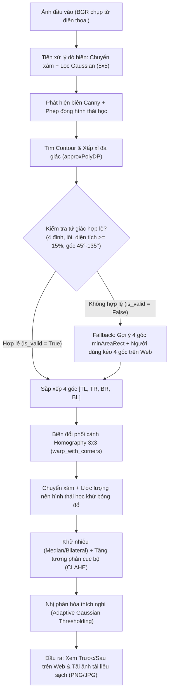

# Hệ thống Quét và Cải thiện Chất lượng Tài liệu (`enhance-docs-quality`)

Báo cáo và mã nguồn Bài tập lớn môn **Xử lý ảnh số (Digital Image Processing)**.

---

## 1. Cấu trúc thư mục & Phân quyền sở hữu file (Chống xung đột Git)

Repo được thiết kế tách biệt hoàn toàn file theo từng thành viên (**TV1, TV2, TV3, TV4**) để cả nhóm code song song và tạo Pull Request vào `main` mà **không bao giờ đụng file của nhau**:

```text
enhance-docs-quality/
├── core/                         # Giao diện xử lý ảnh cốt lõi
│   ├── __init__.py               # [KHÓA GIAO DIỆN] Export chung — KHÔNG AI CẦN SỬA
│   ├── detector.py               # [TV1 SỞ HỮU] detect_corners(), order_corners(), validate_quadrilateral()
│   ├── warp.py                   # [TV1 SỞ HỮU] warp_with_corners(), compute_output_dimensions()
│   ├── enhancer.py               # [TV2 SỞ HỮU] enhance(), remove_shadow_bg(), apply_clahe(), apply_threshold()
│   └── pipeline.py               # [TV4 SỞ HỮU] process_document() kết nối 3 hàm chính + đo thời gian
├── web/                          # Ứng dụng Web (Backend + Frontend)
│   ├── app.py                    # [TV4 SỞ HỮU] Backend API (/api/scan, /api/rewarp)
│   └── static/                   # [TV4 SỞ HỮU] Giao diện người dùng
│       ├── index.html            #   Khung tải ảnh, xem Trước/Sau, Canvas kéo 4 góc
│       ├── style.css             #   Định dạng bố cục 2 cột
│       └── app.js                #   Logic kéo thả 4 đỉnh trên Canvas & gọi API
├── experiments/                  # Thực nghiệm, đánh giá & vùng nháp riêng cho từng thành viên
│   ├── tv1_sandbox.py            # [TV1 SỞ HỮU] Script test riêng cho TV1 (lưu ảnh vào outputs/tv1/)
│   ├── tv2_sandbox.py            # [TV2 SỞ HỮU] Script test riêng cho TV2 (lưu ảnh vào outputs/tv2/)
│   ├── metrics.py                # [TV3 SỞ HỮU] Các độ đo: IoU tứ giác, sai số góc, PSNR, SSIM, tương phản
│   ├── evaluate.py               # [TV3 SỞ HỮU] Chạy Ablation, so sánh Otsu vs Adaptive, đánh giá Fallback
│   └── seed_week1_dataset.py     # [TV3 SỞ HỮU] Khởi tạo dữ liệu mẫu đợt 1
├── data/                         # Bộ dữ liệu ảnh tài liệu và nhãn (TV3 quản lý)
│   ├── raw/                      # 36 ảnh đầu tiên (doc_001.jpg .. doc_036.jpg)
│   ├── metadata.csv              # Nhãn tọa độ 4 góc [TL, TR, BR, BL] & nhóm điều kiện
│   └── README.md                 # Thống kê dữ liệu
├── report_draft.md               # Bản nháp báo cáo định dạng Markdown (tất cả cùng cập nhật theo mục riêng)
├── report_draft.docx             # File mẫu gốc (giữ nguyên không chỉnh sửa)
├── timeline.md                   # Kế hoạch phân công 8 tuần (đã bỏ OCR, xuất PDF, chọn chế độ)
└── requirements.txt              # Danh sách thư viện Python
```

### Bảng phân quyền File cho từng thành viên

| Thành viên | Phụ trách chuyên môn | Các file ĐƯỢC SỬA | Script chạy thử riêng |
|:---:|---|---|---|
| Nguyễn Thị Ngọc Mai | Phát hiện biên, kiểm tra tứ giác hợp lệ, biến đổi phối cảnh, gợi ý góc fallback | `core/detector.py`<br>`core/warp.py` | `python experiments/tv1_sandbox.py` |
| Khổng Thị Thùy Linh | Chuyển xám, khử bóng đổ hình thái học, khử nhiễu, CLAHE, nhị phân hóa (Otsu & Adaptive) | `core/enhancer.py` | `python experiments/tv2_sandbox.py` |
| Nguyễn Thị Anh Ngọc | Dữ liệu, gán nhãn 4 góc, độ đo đánh giá (IoU, PSNR, SSIM, độ đồng nhất nền), thí nghiệm | `experiments/metrics.py`<br>`experiments/evaluate.py`<br>`data/*` | `python experiments/evaluate.py` |
| Đoàn Thị Hồng Nhung | Web Backend/Frontend, xem Trước/Sau, Canvas kéo 4 góc thủ công, tải ảnh kết quả | `web/app.py`<br>`web/static/*`<br>`core/pipeline.py` | `python -m web.app` |

> **Quy tắc làm việc nhóm tránh xung đột:**
> 1. Mỗi thành viên tạo nhánh riêng theo tên mình (ví dụ: `git checkout -b tv1/corner-detection`, `tv2/enhancement`, `tv3/evaluation`, `tv4/web-ui`).
> 2. **Tuyệt đối không đổi tên hàm hoặc kiểu dữ liệu đầu vào/đầu ra** của 3 hàm giao diện chính (`detect_corners`, `warp_with_corners`, `enhance`) đã chốt trong `core/`.
> 3. Mở file mình phụ trách và tìm từ khóa `TODO (TVx - Tuần y)` để làm theo đúng hướng dẫn từng bước đã ghi sẵn trong code.

---

## 2. Sơ đồ Pipeline v0



---

## 3. Giao diện 3 hàm cốt lõi (`core/`)

| Hàm | Module | Phụ trách | Chữ ký hàm (Signature) | Đầu vào & Đầu ra |
|---|---|---|---|---|
| `detect_corners` | [core/detector.py](file:///e:/nnnnn/p-xla/enhance-docs-quality/core/detector.py) | TV1 | `detect_corners(image: np.ndarray, config: dict \| None = None) -> dict` | Nhận ảnh BGR/xám; trả về `dict` gồm `corners` `(4, 2)` theo thứ tự `[TL, TR, BR, BL]`, `is_valid` (`bool`), `confidence` (`float`), `fallback_reason`, `debug_info`. |
| `warp_with_corners` | [core/warp.py](file:///e:/nnnnn/p-xla/enhance-docs-quality/core/warp.py) | TV1 | `warp_with_corners(image: np.ndarray, corners: np.ndarray, output_size: tuple[int, int] \| None = None) -> np.ndarray` | Nhận ảnh gốc và mảng `corners` `(4, 2)`; trả về ảnh tài liệu đã cắt nền thừa và duỗi phẳng phối cảnh (`uint8`). |
| `enhance` | [core/enhancer.py](file:///e:/nnnnn/p-xla/enhance-docs-quality/core/enhancer.py) | TV2 | `enhance(image: np.ndarray, remove_shadow: bool = True, denoise: bool = True, use_clahe: bool = True, binarize: bool = True, config: dict \| None = None) -> np.ndarray` | Nhận ảnh tài liệu phẳng; trả về ảnh tài liệu 1 kênh (`uint8`) đã khử bóng, khử nhiễu, tăng tương phản CLAHE và nhị phân hóa sắc nét. |

---

## 4. Kiểm tra nhanh (Smoke Test)

```bash
python experiments/tv1_sandbox.py
python experiments/tv2_sandbox.py
python experiments/evaluate.py
```
