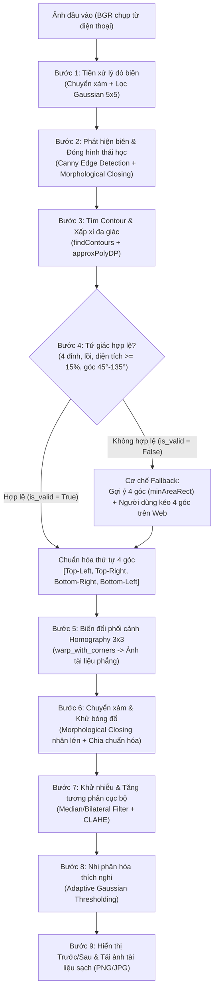

# Hệ thống quét và cải thiện chất lượng tài liệu

**Báo cáo bài tập lớn môn Xử lý ảnh số (Digital Image Processing)**  
**Giảng viên hướng dẫn:** [Họ tên thầy/cô]  
**Nhóm:** [Số nhóm] | **Lớp:** [Mã lớp] | **Học kỳ:** [HK/Năm học]

---

## Thành viên và phân công đóng góp

| STT | Họ tên | MSSV | Phần phụ trách | % đóng góp |
|:---:|---|---|---|:---:|
| 1 | [Tên TV1] | [MSSV] | Phát hiện biên, kiểm tra tứ giác hợp lệ, hiệu chỉnh phối cảnh, cắt nền & fallback (`detect_corners`, `warp_with_corners`) | 25% |
| 2 | [Tên TV2] | [MSSV] | Tiền xử lý và tăng cường chất lượng ảnh: chuyển xám, loại bóng đổ hình thái học, khử nhiễu, tăng tương phản CLAHE, nhị phân hóa (`enhance`) | 25% |
| 3 | [Tên TV3] | [MSSV] | Xây dựng dữ liệu, gán nhãn 4 góc, thiết kế thí nghiệm, cài đặt các độ đo đánh giá (IoU, sai số góc, PSNR, SSIM, độ đồng nhất nền) | 25% |
| 4 | [Tên TV4] | [MSSV] | Ứng dụng Web, giao diện xem Trước/Sau, giao diện Canvas kéo 4 góc thủ công, tải ảnh kết quả, tích hợp pipeline, video demo | 25% |

---

## Tóm tắt

*(Bản nháp sơ bộ Tuần 1 — sẽ cập nhật số liệu thực nghiệm ở Tuần 5–7)*  
Trong thực tế, việc sử dụng camera điện thoại thông minh để chụp lại các văn bản hành chính, hóa đơn, tài liệu học tập hoặc biểu mẫu ngày càng phổ biến nhờ tính tiện lợi. Tuy nhiên, ảnh chụp trực tiếp từ điện thoại thường gặp nhiều suy giảm chất lượng như biến dạng phối cảnh do góc chụp nghiêng, lẫn vùng nền thừa lộn xộn, ánh sáng phân bố không đồng đều, bóng đổ từ tay người chụp hoặc thiết bị, và độ tương phản thấp giữa chữ với nền giấy. Báo cáo này trình bày việc thiết kế và xây dựng **Hệ thống quét và cải thiện chất lượng tài liệu** dựa trên các kỹ thuật xử lý ảnh số cổ điển kết hợp cơ chế tương tác người–máy thông minh. Pipeline đề xuất bao gồm ba giai đoạn xử lý chính: (1) phát hiện biên tài liệu bằng lọc làm mịn Gaussian, dò biên Canny và xấp xỉ đa giác trên contour đi kèm cơ chế kiểm tra tứ giác lồi hợp lệ; (2) hiệu chỉnh phối cảnh bằng phép biến đổi Homography $3 \times 3$ kết hợp cơ chế **fallback cho phép người dùng kéo chỉnh 4 góc thủ công** khi ảnh đầu vào quá phức tạp; (3) tăng cường chất lượng ảnh thông qua ước lượng nền hình thái học để loại bỏ bóng đổ, khử nhiễu, cân bằng biểu đồ mức xám cục bộ (CLAHE) và nhị phân hóa thích nghi (Adaptive Thresholding). Hệ thống được đóng gói thành ứng dụng Web trực quan hỗ trợ so sánh Trước/Sau và được đánh giá định lượng qua tỷ lệ phát hiện góc đúng, chỉ số giao trên hợp (IoU), PSNR/SSIM và độ đồng nhất nền giấy.

---

## 1. Giới thiệu

### 1.1. Phát biểu bài toán

Sự phổ biến của điện thoại thông minh có camera độ phân giải cao đã thay đổi thói quen lưu trữ tài liệu: thay vì sử dụng máy quét phẳng (flatbed scanner) chuyên dụng cồng kềnh, người dùng thường chụp ảnh tài liệu trực tiếp bằng điện thoại. Tuy nhiên, khác với môi trường chiếu sáng chuẩn hóa và mặt phẳng cố định của máy scan, quá trình thu nhận ảnh bằng camera cầm tay trong điều kiện tự nhiên làm phát sinh đồng thời hai nhóm suy giảm lớn: **biến dạng hình học (geometric distortion)** và **suy giảm quang độ (photometric degradation)**.

Bài toán **Quét và cải thiện chất lượng tài liệu (Document Scanning and Quality Enhancement)** được phát biểu chính xác như sau:

- **Đầu vào (Input):** Một ảnh màu kỹ thuật số $I_{\text{in}} \in \{0, 1, \dots, 255\}^{H \times W \times 3}$ (không gian màu BGR/RGB) chụp một trang tài liệu phẳng bằng điện thoại di động. Ảnh đầu vào có thể chứa các yếu tố nhiễu thực tế:
  1. Trang tài liệu nằm ở góc nghiêng bất kỳ so với trục quang học của camera, gây biến dạng phối cảnh (hình chữ nhật biến thành tứ giác lồi bất kỳ).
  2. Bao quanh trang tài liệu là vùng nền thừa (mặt bàn, thảm, vật dụng cá nhân, các tờ giấy khác).
  3. Độ rọi sáng không đồng đều trên bề mặt giấy, có bóng đổ của tay, thân điện thoại hoặc nguồn sáng chéo.
  4. Nhiễu cảm biến trong điều kiện thiếu sáng hoặc mờ nhẹ do rung tay.

- **Đầu ra (Output):** Ảnh tài liệu $I_{\text{out}}$ kích thước $H' \times W'$, trong đó vùng nền ngoài trang giấy đã bị cắt bỏ hoàn toàn, trang tài liệu được duỗi phẳng về góc nhìn trực diện từ trên xuống (top-down/bird's-eye view), bóng đổ bị triệt tiêu, nền giấy trắng sạch đồng nhất, chữ viết/hình in có độ tương phản và độ sắc nét cao tương đương bản quét từ máy scan chuyên dụng.

- **Các thách thức và khó khăn kỹ thuật chính:**
  - *Nền lẫn màu giấy (Low-contrast background):* Khi trang giấy trắng được đặt trên mặt bàn màu trắng, xám nhạt hoặc chồng lên các tờ giấy khác, độ chênh lệch cường độ sáng (gradient) tại ranh giới tờ giấy rất nhỏ, khiến bộ dò biên Canny dễ bị đứt đoạn biên hoặc bắt nhầm biên của vật thể khác.
  - *Bóng đổ cục bộ và chiếu sáng không đều (Shadows and uneven illumination):* Khi chụp tài liệu dưới đèn bàn hoặc ánh sáng tự nhiên bị che khuất bởi tay và điện thoại, trên mặt giấy xuất hiện ranh giới bóng đổ rõ rệt. Các phương pháp phân ngưỡng toàn cục (như ngưỡng cố định hoặc Otsu) sẽ biến toàn bộ vùng bóng đổ thành mảng đen đặc, làm mất hoàn toàn thông tin chữ nằm trong vùng tối.
  - *Nền phức tạp nhiều chi tiết (Cluttered/textured background):* Vân gỗ đậm, gạch lát, bàn phím hoặc các vật dụng xung quanh tạo ra rất nhiều cạnh giả (false edges) và contour nhiễu có cường độ gradient lớn hơn cả cạnh thật của tờ giấy.
  - *Mất góc hoặc che khuất một phần (Occluded corners / truncated borders):* Ngón tay người giữ giấy che mất góc, góc tờ giấy bị quăn/gấp mép hoặc nằm sát rìa khung hình làm đa giác xấp xỉ không còn đủ 4 đỉnh lồi chuẩn.
  - *Bảo toàn các nét chữ mảnh và dấu thanh:* Chữ in cỡ nhỏ, hóa đơn nhiệt phai mực hoặc các dấu thanh mảnh rất dễ bị đứt nét nếu lọc nhiễu quá mạnh hoặc chọn tham số ngưỡng nhị phân không phù hợp.

### 1.2. Ứng dụng thực tế

Một hệ thống quét và tăng cường chất lượng ảnh tài liệu hoạt động ổn định mang lại giá trị ứng dụng rộng rãi trong nhiều lĩnh vực:

1. **Số hóa hồ sơ hành chính, pháp lý và doanh nghiệp:** Hỗ trợ nhân viên văn phòng và người dân chụp hợp đồng, hóa đơn, biểu mẫu, biên lai thu phí để lưu trữ điện tử hoặc nộp trực tuyến trên cổng dịch vụ công mà không cần máy quét chuyên dụng.
2. **Giáo dục và học tập từ xa:** Sinh viên và giảng viên sử dụng để chụp đề thi, bài tập, tài liệu tham khảo, giáo trình và nộp bài qua hệ thống quản lý học tập (LMS) với chất lượng hình ảnh sạch, phẳng và dễ đọc.
3. **In ấn văn phòng (Photocopy kỹ thuật số):** Khi in lại một bức ảnh chụp điện thoại chưa qua xử lý, toàn bộ vùng nền xám tối và bóng đổ của tờ giấy sẽ tiêu tốn lượng lớn mực in và tạo ra bản in lem nhem; việc cắt bỏ nền ngoài và chuẩn hóa nền giấy về màu trắng sạch giúp bản in rõ ràng như bản gốc.
4. **Chuẩn hóa dữ liệu đầu vào cho các hệ thống lưu trữ và phân tích văn bản:** Ảnh tài liệu đã được nắn thẳng phối cảnh (rectified) và khử bóng là bước tiền xử lý bắt buộc trước khi đưa vào các kho lưu trữ số hóa lâu dài.

**Các ứng dụng thương mại tương tự dùng làm đối chứng:**  
Hiện nay trên thị trường có các ứng dụng di động nổi tiếng như **CamScanner**, **Adobe Scan** và **Microsoft Lens**. Trong khuôn khổ đề tài này, nhóm sử dụng kết quả đầu ra của **CamScanner / Adobe Scan** trên cùng bộ ảnh kiểm thử làm mốc đối chứng thực tế (benchmark) để đánh giá ưu điểm, hạn chế của một pipeline xử lý ảnh số cổ điển minh bạch, giải thích được từng bước toán học.

### 1.3. Mục tiêu và phạm vi

#### Mục tiêu của đề tài
- **Về mặt thuật toán:** Thiết kế, cài đặt và làm chủ toàn bộ chuỗi thuật toán xử lý ảnh số cổ điển cho bài toán quét tài liệu, từ bước lọc làm mịn Gaussian, phát hiện biên Canny, tìm contour, xấp xỉ đa giác Ramer–Douglas–Peucker (`approxPolyDP`), biến đổi phối cảnh Homography $3 \times 3$, đến các kỹ thuật ước lượng nền hình thái học khử bóng, cân bằng biểu đồ thích nghi có giới hạn tương phản (CLAHE) và phân ngưỡng thích nghi (Adaptive Mean/Gaussian Thresholding).
- **Về mặt thực nghiệm và đánh giá:** Xây dựng bộ dữ liệu tối thiểu 100 ảnh chụp thực tế đa điều kiện (kèm nhãn tọa độ 4 góc chuẩn và tập ảnh phẳng tham chiếu). Thực hiện các thí nghiệm nghiên cứu cắt bỏ thành phần (ablation study), so sánh các phương pháp phân ngưỡng (Otsu và Adaptive Thresholding), đánh giá hiệu quả của cơ chế fallback và đối sánh định lượng/định tính với ứng dụng thương mại thông qua các chỉ số: tỷ lệ phát hiện góc đúng, sai số góc (pixel), IoU tứ giác, PSNR/SSIM, độ đồng nhất nền và thời gian thực thi.
- **Về mặt sản phẩm phần mềm:** Xây dựng ứng dụng Web hoàn chỉnh cho phép người dùng tải ảnh lên, tự động phát hiện và cắt phẳng tài liệu, trực quan hóa so sánh Trước/Sau (Before/After), kéo chỉnh 4 góc thủ công khi cần thiết và tải ảnh tài liệu sạch về máy.

#### Phạm vi nghiên cứu
- **Đối tượng hỗ trợ tốt:**
  - Tài liệu một trang phẳng (giấy A4, A5, hóa đơn, trang sách phẳng, văn bản hành chính, biểu mẫu có bảng biểu).
  - Ảnh chụp có góc nghiêng phối cảnh vừa và lớn (tới khoảng $45^\circ$), có bóng đổ cục bộ, ánh sáng không đều hoặc nền bàn thông thường.
- **Giới hạn ngoài phạm vi (Out-of-scope):**
  - Tài liệu bị biến dạng phi tuyến nặng như trang sách dày bị cong phồng ở gáy (3D cylindrical/non-rigid dewarping) hoặc giấy bị vò nhàu nát nhiều nếp gấp.
  - Ảnh chụp thiếu sáng cực đoan hoặc bị nhòe chuyển động nặng (severe motion blur) khiến chữ không còn phân biệt được bằng mắt thường.

#### Điểm nhấn và đóng góp thực tiễn của nhóm
1. **Cơ chế kiểm tra tứ giác hợp lệ kết hợp Fallback kéo 4 góc thủ công (Human-in-the-loop Fallback):** Thay vì để pipeline trả về ảnh bị cắt sai hoặc biến dạng méo mó khi thuật toán tự động thất bại trên nền đồng màu/phức tạp, hệ thống tự động kiểm định tính hợp lệ hình học của tứ giác (số đỉnh, tính lồi, tỷ lệ diện tích, góc trong) và chuyển mượt mà sang giao diện tương tác để người dùng kéo 4 đỉnh về đúng góc trang giấy.
2. **Quy trình khử bóng bảo toàn chi tiết chữ:** Kết hợp ước lượng nền bằng phép đóng hình thái học (Morphological Closing) nhân lớn với phép chia chuẩn hóa trước khi áp dụng CLAHE và ngưỡng thích nghi, khắc phục triệt để nhược điểm mất chữ trong vùng bóng râm của ngưỡng toàn cục.

### 1.4. Bố cục báo cáo

Báo cáo được tổ chức thành 10 chương cùng phần Tài liệu tham khảo và Phụ lục như sau:

- **Chương 1 — Giới thiệu:** Phát biểu bài toán quét và cải thiện chất lượng tài liệu, phân tích các thách thức thực tế, nêu ứng dụng, mục tiêu, phạm vi và bố cục báo cáo.
- **Chương 2 — Cơ sở lý thuyết và các kỹ thuật sử dụng:** Trình bày nền tảng toán học, công thức và vai trò của từng kỹ thuật trong pipeline (Lọc Gaussian, Canny, Contour & xấp xỉ đa giác, Homography, chuyển xám & Otsu, Adaptive Thresholding, khử bóng/khử nhiễu/CLAHE, và các độ đo đánh giá).
- **Chương 3 — Dữ liệu:** Mô tả quy trình thu thập, gán nhãn bộ dữ liệu và phân tích thống kê các nhóm điều kiện chụp đầu vào.
- **Chương 4 — Pipeline đề xuất:** Trình bày sơ đồ khối tổng quan của hệ thống, mô tả chi tiết đầu vào/đầu ra, bộ tham số của từng bước và tiêu chí kiểm tra tứ giác hợp lệ + fallback.
- **Chương 5 — Cài đặt hệ thống:** Mô tả công nghệ sử dụng, cấu trúc thư mục mã nguồn, chữ ký 3 hàm cốt lõi trong package `core`, kiến trúc ứng dụng Web và giao diện kéo 4 góc thủ công.
- **Chương 6 — Thiết kế thí nghiệm:** Nêu các câu hỏi nghiên cứu, các cấu hình thực nghiệm (Ablation study, so sánh phương pháp phân ngưỡng, đánh giá fallback, đối sánh với ứng dụng thương mại) và định nghĩa chi tiết các độ đo.
- **Chương 7 — Kết quả và đánh giá:** Trình bày và phân tích các bảng kết quả định lượng, hình ảnh so sánh định tính, hiệu quả của cơ chế fallback và thống kê thời gian xử lý.
- **Chương 8 — Phân tích các trường hợp thất bại:** Đi sâu phân tích nguyên nhân kỹ thuật, tần suất xuất hiện và giải pháp khắc phục cho các ca lỗi điển hình ở từng mô-đun (phát hiện biên và tăng cường chất lượng).
- **Chương 9 — Demo sản phẩm:** Mô tả kịch bản video demo thực tế và hướng dẫn cài đặt, vận hành hệ thống.
- **Chương 10 — Kết luận và hướng phát triển:** Tổng kết những kết quả đạt được so với mục tiêu đề ra, nhìn nhận trung thực các hạn chế và đề xuất hướng cải tiến trong tương lai.

---

## 2. Cơ sở lý thuyết và các kỹ thuật sử dụng

*(Nội dung chi tiết mục 2.1 – 2.8 sẽ được TV1, TV2, TV3 hoàn thiện ở Tuần 2–4 theo đúng phân công)*

### 2.1. Lọc Gaussian (Gaussian filtering) — TV1
- *[Công thức kernel 2D Gaussian, vai trò làm mịn giảm nhiễu tần số cao trước khi tính đạo hàm dò biên, ảnh hưởng của kích thước kernel $k \times k$ và độ lệch chuẩn $\sigma$]*

### 2.2. Phát hiện biên Canny — TV1
- *[Các bước: tính biên độ và hướng gradient Sobel, triệt phi cực đại (non-maximum suppression), ngưỡng kép ($T_{\text{low}}, T_{\text{high}}$) và nối biên theo trễ (hysteresis)]*

### 2.3. Phát hiện contour và xấp xỉ đa giác — TV1
- *[Thuật toán `findContours`, thuật toán Ramer–Douglas–Peucker (`approxPolyDP`) với tham số $\epsilon = \alpha \cdot \text{chu vi}$, tiêu chí chọn contour tờ giấy: diện tích lớn nhất, 4 đỉnh, đa giác lồi]*

### 2.4. Biến đổi phối cảnh (Perspective transformation) — TV1
- *[Ma trận Homography $H \in \mathbb{R}^{3 \times 3}$, cách chuẩn hóa thứ tự 4 góc `[TL, TR, BR, BL]`, công thức tính chiều rộng $W'$ và chiều cao $H'$ của ảnh phẳng đầu ra]*

### 2.5. Chuyển ảnh xám và ảnh nhị phân — TV2
- *[Công thức độ chói chuẩn $Y = 0.299R + 0.587G + 0.114B$; phân ngưỡng toàn cục và thuật toán Otsu cực đại hóa phương sai giữa hai lớp]*

### 2.6. Ngưỡng thích nghi (Adaptive thresholding) — TV2
- *[Phương pháp trung bình cục bộ (Adaptive Mean) và trọng số Gaussian (Adaptive Gaussian), vai trò của kích thước lân cận `blockSize` và hằng số bù `C` dưới điều kiện chiếu sáng không đều]*

### 2.7. Loại bỏ bóng, khử nhiễu và tăng tương phản — TV2
- *[Ước lượng nền chiếu sáng bằng phép đóng hình thái học (Morphological Closing) hoặc lọc làm mờ nhân lớn, phép chia chuẩn hóa khử bóng; lọc trung vị (Median) / lọc song phương (Bilateral); thuật toán CLAHE]*

### 2.8. Các độ đo đánh giá chất lượng — TV3
- *[Định nghĩa và công thức toán học của: Sai số khoảng cách Euclid trung bình tại 4 đỉnh góc, Chỉ số giao trên hợp đa giác (Polygon IoU), PSNR, SSIM, Độ lệch chuẩn nền sáng (`bg_std`) và Độ tương phản chữ–nền (`fg_bg_contrast`)]*

---

## 3. Dữ liệu

### 3.1. Xây dựng hoặc lựa chọn bộ dữ liệu — TV3 (Khởi tạo Đợt 1 — Tuần 1)

Trong Tuần 1, nhóm đã khởi tạo cấu trúc lưu trữ tại thư mục `data/` và thu thập/khởi tạo **đợt 1 gồm 36 ảnh tài liệu** (`data/raw/doc_001.jpg` đến `data/raw/doc_036.jpg`) kèm tệp nhãn `data/metadata.csv` ghi nhận tọa độ 4 góc chuẩn `[TL, TR, BR, BL]` và nhóm điều kiện chụp. Trong Tuần 2, bộ dữ liệu sẽ được mở rộng lên tối thiểu **100 ảnh** kèm ảnh tham chiếu phẳng (ground truth) cho 20–30 ảnh đại diện để đánh giá PSNR/SSIM.

| Nguồn dữ liệu | Số ảnh (Tuần 1) | Mục tiêu (Tuần 2) | Điều kiện thu nhận | Có Ground Truth không |
|---|:---:|:---:|---|---|
| Bộ dữ liệu nhóm xây dựng (`data/raw/`) | 36 ảnh | $\ge 100$ ảnh | Đa dạng: nền đơn giản, nghiêng phối cảnh lớn, ánh sáng không đều, có bóng đổ, nền đồng màu/phức tạp, biểu mẫu/hóa đơn | Có tọa độ 4 góc trong `data/metadata.csv` (bổ sung ảnh phẳng tham chiếu chuẩn ở Tuần 2) |

### 3.2. Phân tích đặc điểm dữ liệu đầu vào — TV3

Bảng phân bố 36 ảnh đầu tiên trong Tuần 1 theo 6 nhóm điều kiện thực tế:

| Nhóm điều kiện (`condition_group`) | Mã ảnh | Số lượng | Đặc điểm kỹ thuật & Thách thức dự kiến |
|---|---|:---:|---|
| 1. `normal_simple_bg` | `doc_001` – `doc_006` | 6 | Ánh sáng đều, nền tối tương phản cao, góc nghiêng nhẹ ($<15^\circ$). Nhóm cơ sở (baseline) dễ phát hiện góc nhất. |
| 2. `tilted_perspective` | `doc_007` – `doc_012` | 6 | Góc chụp nghiêng lớn, biến dạng phối cảnh hình thang mạnh. Kiểm tra khả năng sắp xếp góc và nội suy khi warp. |
| 3. `uneven_lighting` | `doc_013` – `doc_018` | 6 | Ánh sáng phân bố gradient sáng–tối rõ rệt trên mặt giấy. Thách thức đối với ngưỡng toàn cục Otsu. |
| 4. `shadow_cast` | `doc_019` – `doc_024` | 6 | Bóng đổ chéo qua trang tài liệu làm giảm độ tương phản cục bộ và dễ tạo biên giả dọc ranh giới bóng. |
| 5. `similar_or_cluttered_bg` | `doc_025` – `doc_030` | 6 | **Nhóm dự kiến khó nhất cho `detect_corners`:** nền sáng màu gần giống giấy trắng hoặc có nhiều đường vân/chi tiết gây nhiễu contour. |
| 6. `receipt_and_table` | `doc_031` – `doc_036` | 6 | Tài liệu có khung bảng kẻ ô và chữ cỡ nhỏ; dễ bị bắt nhầm khung bảng bên trong thay vì viền tờ giấy ngoài cùng. |

---

## 4. Pipeline đề xuất (Phiên bản v0 — Chốt Tuần 1)

### 4.1. Sơ đồ tổng quan

Sơ đồ khối tổng quan của **Pipeline v0** được cả nhóm thống nhất như sau:



### 4.2. Mô tả từng bước và bảng tham số khởi tạo (Pipeline v0)

| Bước | Kỹ thuật sử dụng | Hàm phụ trách | Tham số chính | Giá trị khởi tạo (v0) | Lý do lựa chọn |
|---|---|---|---|---|---|
| **1. Tiền xử lý dò biên** | Chuyển xám, lọc Gaussian (`cv2.GaussianBlur`) | `detect_corners` (TV1) | `gaussian_ksize`, `sigma` | `ksize = (5, 5)`, `sigma = 1.2` | Làm mượt nhiễu hạt giấy và vân chữ nhỏ để tránh sinh cạnh giả khi tính đạo hàm dò biên. |
| **2. Phát hiện biên** | Dò biên Canny (`cv2.Canny`) + phép đóng (`cv2.morphologyEx`) | `detect_corners` (TV1) | `canny_low`, `canny_high`, `morph_ksize` | `canny_low = 50`, `canny_high = 150`, `ksize = (5, 5)` | Tỷ lệ ngưỡng $1:3$ theo khuyến nghị của Canny; phép đóng nối liền các đoạn biên tờ giấy bị đứt quãng. |
| **3. Tìm contour & xấp xỉ đa giác** | `cv2.findContours` (`RETR_LIST`) + `cv2.approxPolyDP` | `detect_corners` (TV1) | `top_k_contours`, `approx_eps_ratio` | `top_k = 5`, `eps = 0.02 * perimeter` | Xét 5 contour có diện tích lớn nhất; hệ số $2\%$ chu vi đủ để làm phẳng viền giấy hơi cong nhẹ về đúng 4 đỉnh. |
| **4. Kiểm tra tứ giác & chuẩn hóa góc** | Kiểm định hình học + sắp xếp theo tổng/hiệu tọa độ | `detect_corners`, `order_corners` (TV1) | `min_area_ratio`, `angle_range` | `min_area_ratio = 0.15`, góc trong $[45^\circ, 135^\circ]$ | Loại bỏ các contour nhiễu quá nhỏ hoặc bị suy biến nhọn trước khi tính ma trận Homography. |
| **5. Biến đổi phối cảnh** | `cv2.getPerspectiveTransform` + `cv2.warpPerspective` | `warp_with_corners` (TV1) | `interpolation`, `border_mode` | `INTER_CUBIC`, `BORDER_REPLICATE` | Nội suy bậc ba giữ độ sắc nét của ký tự tốt hơn nội suy tuyến tính sau khi kéo giãn phối cảnh. |
| **6. Loại bỏ bóng đổ** | Ước lượng nền bằng phép đóng hình thái học nhân lớn + chia chuẩn hóa | `enhance` (TV2) | `bg_kernel_size` | `31` | Nhân hình thái học lớn hơn độ dày nét chữ giúp xóa chữ, chỉ giữ lại trường độ sáng nền/bóng đổ để chia chuẩn hóa. |
| **7. Khử nhiễu & Tăng tương phản** | Lọc trung vị + `cv2.createCLAHE` | `enhance` (TV2) | `denoise_ksize`, `clipLimit`, `tileGridSize` | `ksize = 3`, `clipLimit = 2.0`, `tileGridSize = (8, 8)` | Tăng độ tương phản cục bộ giữa nét chữ mờ và nền giấy mà không khuếch đại nhiễu quá mức ở vùng đồng nhất. |
| **8. Nhị phân hóa** | Ngưỡng thích nghi Gaussian (`cv2.adaptiveThreshold`) | `enhance` (TV2) | `block_size`, `c_offset` | `block_size = 21`, `c_offset = 10` | Thích nghi cục bộ theo từng vùng lân cận $21 \times 21$, giữ nét chữ rõ và nền giấy trắng sạch. |

### 4.3. Cơ chế kiểm tra tứ giác hợp lệ và fallback — TV1

Một tứ giác ứng viên $Q = \{P_1, P_2, P_3, P_4\}$ tìm được từ bước xấp xỉ contour chỉ được đánh dấu là **hợp lệ (`is_valid = True`)** khi thỏa mãn đồng thời 4 điều kiện hình học:
1. **Đúng 4 đỉnh:** Đa giác sau `approxPolyDP` có đúng 4 đỉnh phân biệt.
2. **Tính lồi (Convexity):** `cv2.isContourConvex(Q) == True`, đảm bảo tứ giác không tự cắt hoặc lõm vào trong.
3. **Tỷ lệ diện tích tối thiểu:** Diện tích tứ giác chiếm ít nhất $15\%$ diện tích toàn khung hình ($\text{Area}(Q) \ge 0.15 \times W \times H$), tránh bắt nhầm nhãn dán, con dấu hoặc ô bảng nhỏ bên trong trang giấy.
4. **Ràng buộc góc trong:** Mọi góc trong tại 4 đỉnh nằm trong khoảng $[45^\circ, 135^\circ]$, tránh các tứ giác suy biến quá dẹt.

**Khi `is_valid == False` (Cơ chế Fallback):**
- Hàm `detect_corners` trả về bộ 4 góc gợi ý ban đầu (lấy từ hình chữ nhật bao nhỏ nhất `cv2.minAreaRect` của contour lớn nhất nếu có, hoặc khung chữ nhật cách đều lề ảnh $8\%$).
- Giao diện Web nhận cờ `is_valid = False` sẽ tự động bật **chế độ kéo 4 góc thủ công** với 4 nút điều khiển tại 4 đỉnh gợi ý, cho phép người dùng kéo thả trực quan và gửi tọa độ đã chỉnh về hàm `warp_with_corners`.

---

## 5. Cài đặt hệ thống

### 5.1. Công nghệ và môi trường

- **Ngôn ngữ lập trình:** Python 3.10+
- **Thư viện xử lý ảnh & tính toán:** OpenCV (`opencv-python`), NumPy (`numpy`), Pillow (`Pillow`)
- **Ứng dụng Web:** FastAPI / Uvicorn (Backend REST API) + HTML5 Canvas / JavaScript (Frontend kéo thả 4 góc tương tác, xem Trước/Sau)

### 5.2. Cấu trúc mã nguồn và giao diện các module (Hoàn thành Tuần 1)

Cấu trúc kho mã nguồn Git được phân tách theo từng thành viên để tránh xung đột khi làm việc nhóm:

```text
enhance-docs-quality/
  core/
    __init__.py          # Export 3 hàm chính: detect_corners, warp_with_corners, enhance
    detector.py          # Phát hiện 4 góc & kiểm tra tứ giác hợp lệ (TV1)
    warp.py              # Biến đổi phối cảnh Homography 3x3 (TV1)
    enhancer.py          # Khử bóng, khử nhiễu, CLAHE, nhị phân hóa (TV2)
    pipeline.py          # Hàm tích hợp end-to-end process_document() (TV4)
  web/
    app.py               # Backend API kết nối với package core (TV4)
    static/              # Frontend HTML/CSS/JS hiển thị Trước/Sau & Canvas kéo góc (TV4)
  experiments/
    tv1_sandbox.py       # Script test riêng của TV1
    tv2_sandbox.py       # Script test riêng của TV2
    metrics.py           # Các hàm tính sai số góc, IoU, PSNR, SSIM, độ đồng nhất nền (TV3)
    evaluate.py          # Script chạy Ablation, so sánh ngưỡng, đánh giá Fallback (TV3)
    seed_week1_dataset.py# Sinh bộ dữ liệu mẫu đợt 1 (TV3)
  data/
    raw/                 # 36 ảnh chụp đầu tiên (doc_001.jpg .. doc_036.jpg)
    metadata.csv         # Nhãn tọa độ 4 góc & phân nhóm điều kiện
    README.md
  report_draft.md        # Bản nháp báo cáo định dạng Markdown
  timeline.md            # Kế hoạch thực hiện 8 tuần
  requirements.txt
  README.md
```

**Chữ ký (Signature) của 3 hàm cốt lõi trong `core/`:**

1. **Phát hiện 4 góc tài liệu — Phụ trách: TV1 (`core/detector.py`)**
   ```python
   def detect_corners(
       image: np.ndarray,
       config: dict[str, Any] | None = None,
   ) -> dict[str, Any]:
       """Trả về dict gồm:
       - 'corners': np.ndarray shape (4, 2), dtype float32 theo thứ tự [TL, TR, BR, BL]
       - 'is_valid': bool (True nếu tứ giác hợp lệ, False nếu cần fallback chỉnh tay)
       - 'confidence': float (0.0 -> 1.0)
       - 'fallback_reason': str | None
       - 'debug_info': dict
       """
   ```

2. **Biến đổi phối cảnh từ 4 góc — Phụ trách: TV1 (`core/warp.py`)**
   ```python
   def warp_with_corners(
       image: np.ndarray,
       corners: np.ndarray,
       output_size: tuple[int, int] | None = None,
   ) -> np.ndarray:
       """Nhận ảnh gốc và mảng corners (4, 2), trả về ảnh tài liệu đã cắt nền và làm phẳng."""
   ```

3. **Tăng cường chất lượng ảnh tài liệu — Phụ trách: TV2 (`core/enhancer.py`)**
   ```python
   def enhance(
       image: np.ndarray,
       remove_shadow: bool = True,
       denoise: bool = True,
       use_clahe: bool = True,
       binarize: bool = True,
       config: dict[str, Any] | None = None,
   ) -> np.ndarray:
       """Trả về ảnh tài liệu đã chuyển xám, khử bóng, khử nhiễu, tăng tương phản CLAHE và nhị phân hóa."""
   ```

### 5.3. Ứng dụng web — TV4
- *[Cập nhật ở Tuần 2–3: Kiến trúc client–server, luồng xử lý tải ảnh lên → xử lý → xem Trước/Sau → tải ảnh kết quả về máy, kèm ảnh chụp màn hình]*

### 5.4. Giao diện kéo 4 góc thủ công — TV4
- *[Cập nhật ở Tuần 4: Cơ chế kích hoạt khi `is_valid == False` hoặc khi người dùng bấm nút chỉnh góc, cách quy đổi tọa độ Canvas về tọa độ ảnh gốc]*

---

## 6. Thiết kế thí nghiệm — TV3

*(Cập nhật chi tiết ở Tuần 4–5)*

### 6.1. Câu hỏi nghiên cứu
1. Từng bước trong pipeline (làm phẳng phối cảnh, loại bóng đổ, CLAHE, ngưỡng thích nghi) đóng góp bao nhiêu phần trăm cải thiện vào chất lượng ảnh đầu ra (PSNR/SSIM, độ đồng nhất nền, độ tương phản chữ–nền)?
2. Phương pháp phân ngưỡng thích nghi (Adaptive Mean / Adaptive Gaussian) vượt trội như thế nào so với ngưỡng toàn cục Otsu trên nhóm ảnh có bóng đổ và ánh sáng không đều?
3. Cơ chế fallback kéo 4 góc thủ công giúp khôi phục được bao nhiêu phần trăm các trường hợp phát hiện biên tự động thất bại?
4. Chất lượng đầu ra của hệ thống so với ứng dụng thương mại (CamScanner / Adobe Scan) đạt mức nào?

### 6.2. Các cấu hình so sánh

| Thí nghiệm | Biến thay đổi | Các cấu hình so sánh | Mục đích |
|---|---|---|---|
| **Ablation Study** | Bỏ/thêm từng bước xử lý | (1) Chỉ chuyển xám + Nhị phân, (2) Warp + Nhị phân, (3) Warp + Khử bóng + Nhị phân, (4) Pipeline đầy đủ (Warp + Khử bóng + Khử nhiễu + CLAHE + Nhị phân) | Đánh giá đóng góp riêng lẻ của từng bước trong pipeline |
| **So sánh phân ngưỡng** | Thuật toán nhị phân hóa | Otsu toàn cục, Adaptive Mean, Adaptive Gaussian | Kiểm chứng hiệu quả xử lý ánh sáng không đều và bóng đổ |
| **Khảo sát tham số** | Tham số chính | `block_size` $\in \{11, 21, 31, 41\}$, ngưỡng Canny | Tìm bộ siêu tham số tối ưu trên tập dữ liệu |
| **So sánh với App** | Hệ thống đối chứng | Hệ thống của nhóm vs. CamScanner / Adobe Scan | Đối sánh thực tế với sản phẩm thương mại |
| **Đánh giá Fallback** | Chế độ xác định góc | Tự động hoàn toàn vs. Tự động + Fallback chỉnh tay | Lượng hóa giá trị của cơ chế tương tác người–máy |

### 6.3. Độ đo đánh giá
- **Độ chính xác phát hiện góc:** Sai số khoảng cách Euclid trung bình tại 4 đỉnh (pixel), chỉ số giao trên hợp (Polygon IoU) và Tỷ lệ phát hiện góc đúng ($\text{IoU} \ge 0.90$).
- **Chất lượng ảnh có tham chiếu:** PSNR (dB) và SSIM trên tập ảnh có bản phẳng chuẩn.
- **Chất lượng ảnh không tham chiếu & Hiệu năng:** Độ lệch chuẩn vùng nền trắng (`bg_std`), độ tương phản chữ–nền (`fg_bg_contrast`) và thời gian xử lý trung bình (ms/ảnh).

---

## 7. Kết quả và đánh giá — TV3 tổng hợp

*(Số liệu thực nghiệm sẽ được điền vào Tuần 4–6)*

### 7.1. Đánh giá định lượng

| Phương pháp / Cấu hình | Phát hiện góc đúng (%) | IoU trung bình | PSNR (dB) / SSIM | Độ lệch chuẩn nền (`bg_std` $\downarrow$) | Thời gian (ms) |
|---|:---:|:---:|:---:|:---:|:---:|
| Ảnh gốc (chỉ chuyển xám + Otsu) | — | — | [...] | [...] | [...] |
| Chỉ biến đổi phối cảnh + Otsu | [...] | [...] | [...] | [...] | [...] |
| Warp + Adaptive Threshold (chưa khử bóng) | [...] | [...] | [...] | [...] | [...] |
| **Pipeline đầy đủ (Đề xuất)** | **[...]** | **[...]** | **[...]** | **[...]** | **[...]** |
| Ứng dụng đối chứng (CamScanner/Adobe Scan) | [...] | [...] | [...] | [...] | [...] |

### 7.2. Đánh giá định tính
- *[Hiển thị 4–6 ví dụ tiêu biểu theo hàng: Ảnh gốc | Kết quả của nhóm | Kết quả ứng dụng đối chứng]*

### 7.3. Hiệu quả của cơ chế fallback
- *[Thống kê tỷ lệ ảnh tự động thất bại và mức cải thiện IoU, PSNR/SSIM sau khi người dùng kéo 4 góc thủ công]*

### 7.4. Thời gian xử lý
- *[Thống kê thời gian chạy trung bình của từng mô-đun: `detect_corners`, `warp_with_corners`, `enhance`]*

---

## 8. Phân tích các trường hợp thất bại

*(Hoàn thiện ở Tuần 6)*

### 8.1. Thất bại ở phát hiện biên và phối cảnh — TV1
- **Nền lẫn màu giấy:** [...]
- **Giấy bị che góc:** [...]
- **Giấy cong hoặc nhàu:** [...]
- **Nền nhiều chi tiết:** [...]

### 8.2. Thất bại ở tăng cường chất lượng — TV2
- **Bóng đậm:** [...]
- **Ánh sáng không đều:** [...]
- **Chữ mờ hoặc nét mảnh bị mất khi nhị phân:** [...]

### 8.3. Tổng hợp và hướng khắc phục — TV3 tổng hợp

| Trường hợp thất bại | Nguyên nhân kỹ thuật | Tần suất gặp | Giải pháp khắc phục |
|---|---|---|---|
| [...] | [...] | [...] | [...] |

---

## 9. Demo sản phẩm

*(Hoàn thiện ở Tuần 7)*
- **Link video demo:** [...]
- **Kịch bản demo:** (1) Quét ảnh đơn giản tự động, (2) Quét ảnh có bóng đổ nặng, (3) Trường hợp nền phức tạp kích hoạt kéo 4 góc thủ công, (4) Xem Trước/Sau và tải ảnh kết quả về máy.

---

## 10. Kết luận và hướng phát triển

*(Hoàn thiện ở Tuần 7–8)*
### 10.1. Kết luận
### 10.2. Hạn chế
### 10.3. Hướng phát triển

---

## Tài liệu tham khảo

1. R. C. Gonzalez and R. E. Woods, *Digital Image Processing*, 4th ed. Pearson, 2018.
2. J. Canny, "A Computational Approach to Edge Detection," *IEEE Transactions on Pattern Analysis and Machine Intelligence*, vol. PAMI-8, no. 6, pp. 679–698, Nov. 1986.
3. N. Otsu, "A Threshold Selection Method from Gray-Level Histograms," *IEEE Transactions on Systems, Man, and Cybernetics*, vol. 9, no. 1, pp. 62–66, Jan. 1979.
4. K. Zuiderveld, "Contrast Limited Adaptive Histograph Equalization," in *Graphics Gems IV*, Academic Press, 1994, pp. 474–485.
5. D. H. Douglas and T. K. Peucker, "Algorithms for the reduction of the number of points required to represent a digitized line or its caricature," *Cartographica*, vol. 10, no. 2, pp. 112–122, 1973.
6. Z. Wang, A. C. Bovik, H. R. Sheikh, and E. P. Simoncelli, "Image quality assessment: from error visibility to structural similarity," *IEEE Transactions on Image Processing*, vol. 13, no. 4, pp. 600–612, Apr. 2004.
7. OpenCV Documentation, "Image Processing (imgproc module)," [Online]. Available: https://docs.opencv.org/

---

## Phụ lục

- **Phụ lục A:** Bảng đóng góp chi tiết từng thành viên
- **Phụ lục B:** Bảng tham số đầy đủ của pipeline
- **Phụ lục C:** Thêm ảnh kết quả thực nghiệm
- **Phụ lục D:** Hướng dẫn cài đặt và chạy hệ thống
